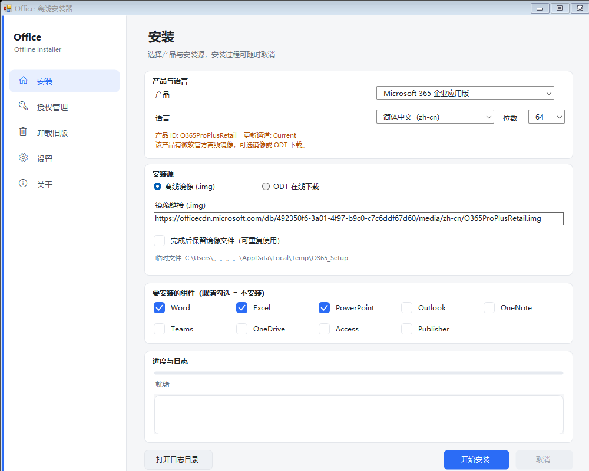
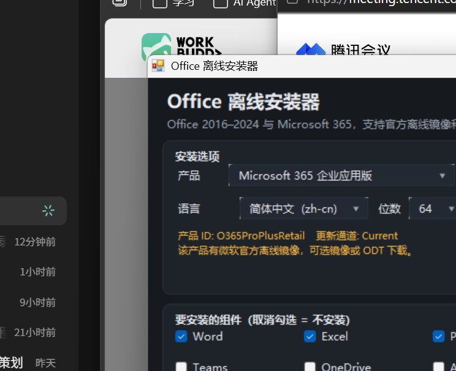

# Office 离线安装器

一个 Windows 图形界面的 Office 部署工具，封装微软官方的 Office 部署工具（ODT），支持从微软官方 CDN 安装 Microsoft 365 与历史版本 Office（2016–2024）。

单文件 exe，约 80 KB，不依赖任何运行库（Windows 10/11 自带 .NET Framework 4.x 即可）。

## 界面





主界面：产品 / 语言 / 位数选择，组件勾选，安装源（离线镜像或 ODT 下载），进度与实时日志。

左侧导航分「安装 / 授权管理 / 卸载旧版 / 设置 / 关于」五个页面；安装页的四张卡片可点击标题折叠展开，明暗双主题，语言与主题选择会被记住（`%LOCALAPPDATA%\OfficeOfflineInstaller\`）。

## 界面语言

支持简体中文 / English / 日本語 / 한국어，右上角下拉即时切换，无需重启；选择会记住（`%LOCALAPPDATA%\OfficeOfflineInstaller\ui-lang.txt`）。

翻译数据按语言分文件存放，新增语言只需加一个 `src/Lang.xx.cs` 并在 `build.ps1` 的文件列表里补一行；未翻译的条目自动回退到英文，再回退到中文。

## 功能

- **安装 Microsoft 365**：企业应用版 / 商业版 / 家庭版
- **安装历史版本**：Office 2016 / 2024 / 2021 / 2019（零售与 LTSC 批量）、Visio、Project、单独应用
- **两种安装源**
  - 离线镜像（`.img`）：下载微软官方镜像后挂载安装，适合反复部署
  - ODT 在线下载：调用 `setup.exe /download` 拉取到本地目录，支持任意产品
- **断点续传**：下载中断可直接重跑，按 `Content-Length` 判断完整性
- **损坏自愈**：镜像校验失败自动删除并重新下载一轮
- **卸载旧版**：独立窗口，可分别卸载即点即用版与 MSI 版，勾选式操作
- **授权管理**：调用微软自带 `OSPP.VBS` 查询状态、安装自有密钥、配置自有 KMS 主机、获取安装 ID、卸载密钥

## 系统要求

- Windows 10 / 11（64 位）
- 管理员权限（程序会自行提权）
- 安装 Microsoft 365 离线镜像约需 13 GB 可用空间

## 使用方法

1. 下载 [Releases](../../releases) 中的 `Office-Installer.exe`
2. 双击运行，UAC 允许后阅读并同意免责声明
3. 选择产品、语言、位数与需要的组件
4. 点「开始安装」

安装源默认使用 Microsoft 365 企业应用版的官方镜像地址，可自行替换为其他产品的镜像链接。

遇到问题先看 [常见问题](docs/FAQ.md)。

## 从源码构建

需要 Windows 自带的 .NET Framework 编译器（通过 PowerShell 的 `Add-Type` 调用）：

```powershell
powershell -ExecutionPolicy Bypass -File build.ps1
```

输出 `Office离线安装器.exe`。`build.ps1 -CheckOnly` 只做编译校验，不覆盖已有 exe。

源码结构：

```
src/
  Installer.cs   主程序：界面与安装流程
  Products.cs    产品目录（产品 ID / 显示名 / 更新通道）
  Common.cs      ODT 获取与执行、HTTP 工具
  Uninstall.cs   卸载旧版 Office
  License.cs     授权管理（OSPP.VBS 封装）
  Consent.cs     免责声明
build.ps1        构建脚本
```

## 说明

- 安装源均来自微软官方 CDN（`officecdn.microsoft.com`），程序不打包、不分发任何微软二进制文件
- 程序不包含破解、激活绕过或修改授权状态的功能
- 使用 Office 需自行具备合法授权，详见 [DISCLAIMER.md](DISCLAIMER.md)

## 许可

源码采用 MIT 许可证，详见 [LICENSE](LICENSE)。Microsoft、Office、Microsoft 365 为微软公司商标，本项目与其无隶属关系。
